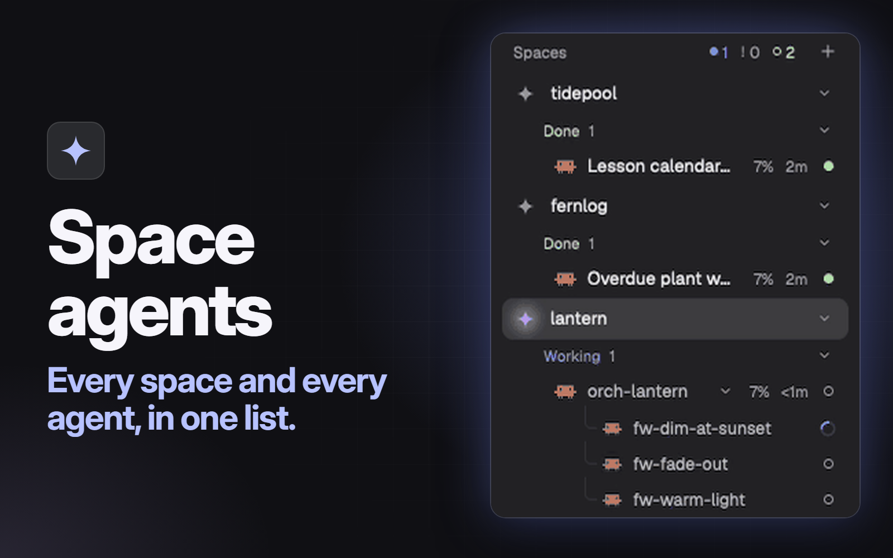

# Space agents

One sidebar list in place of Herdr's separate spaces and agents lists. Each space folds, and under it its agents sit in folds by status: Needs you, Done, Working, Idle. Anyone waiting on you is also listed at the very top, oldest first, with what they're waiting on, so a look at the sidebar says what needs you and where.



## What you see

One block filling the sidebar between Herdr's top row and its footer, on the `chrome` background, 13px text. Top to bottom:

- **Header**, 31px. "Spaces" (11.5px, `dim`) on the left. Then three counts across every space, each `dim` at zero: a 6px `working` dot, a bold `!` in `blocked`, and a 6px `done` ring. Then a 26px `+` button.
- **Needs you inbox**, only when something is waiting. A 26px head, "Needs you" in `blocked` (11px, medium) and its count. Then 40px rows: the program's 16px icon, the agent's name, its space's name (11px `dim`, at most 90px wide), and on a second line what it's waiting on (11px `blocked`). How long it has waited sits at the right (11px `dim`). A 1px `border` line closes the inbox.
- **Machine headers**, only once a machine other than this computer is known. 26px, 11px `dim`: a 13px monitor or server icon, the name ("This computer" for this one), the state when it isn't connected, a `+` when it is, a 6px dot (`ansi2` connected, `dim` not), and a chevron.
- **Space rows**, 30px (28px for a worktree), radius 8, `selected` behind the shown space. A 14px icon in `dim`: a small spark, or a branch mark for a worktree, which sits 22px in under its checkout. The name (`foreground`, at most 150px). Then at the right, 11.5px `dim`, only what's unusual: the repo and branch, such as `billing · spike`, leaving out `main`, `master` and whatever the name already says, then `↑2` in `ansi2` and `↓1` in `ansi1`. A folded space ends with its most urgent status mark (unless that's idle), how many agents it holds, and a chevron.
- **Status heads**, 24px, 30px in, 11px medium. The label in its status color (`blocked`, `done`, `working`; `dim` for Idle), the count in `dim`, and a chevron at the right. A status with no agents isn't drawn.
- **Agent rows**, 28px, 38px in, or 40px when a blocked agent has a reason, which sits on a second line (11px `blocked`). The program's 16px icon, the name (`muted` when idle and not focused), a fold control if it has sub-agents, the context figure, how long since its state changed (`<1m`, `5m`, `2h`, `3d`), and a status mark. `selected` behind the focused agent.
- **Sub-agent rows**, 26px, 60px in, 12.5px `muted`, with tree lines in `input` and a 14px icon. `raised` behind the one shown.
- **No space**, at the end, only when an agent sits in no listed space: an 11px `dim` label, then the same status folds.

**The rail.** Below 160px wide there's no room for folds. Each space is a 28px tile with its icon and its number in the list, with its agents below it in 24px rows of icon and status mark, whatever's folded. The header keeps only the `+`, the inbox goes, and a 28px strip at the bottom holds a `»`.

## How it behaves

- **Working:** a 12px `working` spinner, one turn in 900ms. The space's icon turns `accent` with a slow glow behind it, five rings fading over 1800ms, while an agent or sub-agent in it is working.
- **Blocked:** a 14px tile with a bold `!` in `blocked`. The agent goes to the top of its space, joins the inbox, and counts in the header. The reason is the agent's own report, such as `approve Bash: <command>`. With no message it's the report's kind ("needs permission", "has a question", "needs a sign-in"), and in the inbox with no report at all it's "needs you".
- **Done:** a 7px `done` dot. A done agent you're looking at stays in Done until you leave it.
- **Idle:** a 7px `idle` ring.
- An agent counts as its most urgent sub-agent. A sub-agent stopped on an error counts as blocked and reads "stopped on an error" in the inbox. A sub-agent is never done: its parent's done is the news.
- Within a status, the agent whose state changed last comes first. Going from done to idle doesn't count as a change.
- **Space row:** a press selects it. Dragging it onto another space on the same machine moves it, with a 2px `accent` line showing where. Letting go anywhere else, or leaving the sidebar, ends the drag. A right press opens Herdr's space menu.
- **Chevron on a space or agent:** acts on the press and folds, without selecting the space, starting a drag or focusing the agent. A status head folds when pressed anywhere. A machine head folds its spaces.
- **Agent row or inbox row:** a press goes there. Nothing here answers a dialog. A sub-agent row opens it in a peek over the tab.
- **`cmd-shift-u`** (the Mac key) goes to the agent that has waited longest.
- `agent.next` and `agent.prev` follow the drawn order, including agents in a fold.
- **Header counts** come from what's drawn. Working is every agent, sub-agent and worker with a spinner, each once. Waiting is the inbox's length. Done is what the Done folds hold.
- **Names:** a tab someone named, else the name given with `hc run --name`, else the agent's own title. Agents that would still read the same in one space get their tab's number after a `·`.
- **Context figure:** after a Claude Code session's first turn, its row shows how full the session is, such as `34%`, in `dim`, and in `ansi3` from 60%. It's a share of the usable 80% of the window. A hover says `272k of 1000k context`. It's read every 20 seconds.
- **Same file changed twice:** a space whose checkout has a changed file that another checkout of the same repo also has changed gets a badge in `ansi3` with a 12px compare icon and the count. A hover lists up to six paths.
- **Worker sound:** one quiet note when a terminal with a parent and no pane of its own stops working or ends, whether you're looking or not. Workers finishing within 1.5 seconds play it once. Sounds off in Settings turns it off. Agents with a pane get Herdr's own sounds.
- **Git** is looked at again when a command or an agent's turn ends, when a local repo's files change, and once a minute while the window is in front.
- Folds and each agent's last change survive a restart. A fold for a space that's gone goes too. On another machine it waits until that machine is connected and its layout has been read.
- A new space waits up to 1.5 seconds for its git, so a worktree appears under its repo instead of jumping there.
- **The rail:** pressing a tile selects that space and pressing an agent focuses it. `»` goes back to the earlier width.

## Built from

The layout, a clone of the shipped `main`. The `sidebar` column keeps its 268px, `min` 44 and `max` 480, and now holds three things: `brand` (46px, `workspace-chrome`), the block below, and `sidebar-footer` (69px, `workspace-chrome` with `props: { "footer": true }`). This node in the shipped layout:

```json
{
  "id": "sidebar-lists",
  "type": "column",
  "children": [
    { "id": "spaces", "type": "block", "size": { "weight": 1 }, "min": 90, "content": { "mod": "spaces" } },
    { "id": "agents", "type": "block", "size": { "weight": 1 }, "min": 90, "content": { "mod": "agents" } }
  ]
}
```

becomes this one, in the same place:

```json
{ "id": "space-agents", "type": "block", "size": { "weight": 1 }, "min": 90, "content": { "mod": "space-agents" } }
```

No props. The block takes everything the mod needs from `herdr`.

One mod, `mods/space-agents/`:

- `main.js`: the view, the timers and the app calls.
- `tree.js`: the rules, with no drawing and no app calls: the tree, ranks, the inbox, header counts, names, folds, drop targets, finished workers, shared edits, context share.
- `context.py`: reads each local Claude Code session's latest usage.
- `mod.json`: `{ "place": "none", "title": "Spaces" }`.
- `spark.svg`: the space icon, a four-point spark drawn in `currentColor`, 16px.
- `worker.mp3`: the worker note, 3.4 KB.
- `NOTICE.md` and `LICENSE-Apache-2.0.txt`.

`keys.json`, beside `mods/`, binds `cmd-shift-u` to `space-agents.oldest-blocked` in `global`.

Shipped mods it uses: `workspace-chrome` in the layout, and its icons `branch`, `chevron-down`, `chevron-right`, `git-compare`, `monitor`, `plus`, `server` and `spinner`, read from `mods/workspace-chrome/`. `menu` opens as a 200 by 260 popup with `{ tab: "space", target: { id } }`.

`herdr` functions: `agents`, `terminals`, `panes`, `focused`, `spaces`, `machines`, `layout`, `window`, `theme`, `settings`, `shared`, `setShared`, `setAgentOrder`, `run`, `openOverlay`, `exec`, `hc`, `appHome`, `watchFolder`, `playSound`, `nextCommand`.

Commands: `pane.focus`, `agent.focus`, `terminal.peek`, `space.select`, `space.move`, `space.new`, `layout.resize`.

Shared keys: `sidebar.width` and `sidebar.collapsed` (written, and shared with `workspace-chrome`), `space.colors` (kept up, as the shipped `spaces` does, because the space picker draws them), `chat.unseen` (read only).

Programs: `hc`, `git` and `python3`, listed under Watch out.

## Watch out

- **Built and run on macOS only.** Nothing shows it working on Linux or Windows. On Windows `context.py` stops at `signal.alarm`, which Python doesn't have there, so the context figure never shows.
- **Shipped layouts refuse edits, so clone first.** `herdr-app do layout.clone '{"name":"main","as":"main-space-agents"}'` makes the copy and switches to it. Then make the swap above in `layouts/main-space-agents.json`. On a layout the person already owns, make the swap there instead. An edit to the shipped `main.json` is moved aside on the next start.
- **Nothing shows until the block is in a layout.** `mod.json` says `"place": "none"`, and a gallery mod brings no layout of its own.
- **The rail goes by width.** It reads the `size.px` of the layout node with id `sidebar`, below 160 being narrow. A layout with no such node never gets the rail, and `»` never shows.
- **Getting to the rail and back.** The shipped `workspace-chrome` has the sidebar button that goes to the rail, 76px on macOS and 44px elsewhere. Dragging the sidebar's edge narrower gets there too. On the macOS rail that button is hidden, because the window buttons fill the row, and the shipped `agents` block was what held the `»`. So this mod draws its own `»`. Drop it and there's no way back but dragging. The button and the `»` run the same code on the same keys: `sidebar.width` holds the width to go back to, 268 if none, and `sidebar.collapsed` is written only for mods that still read it. Nothing here reads it.
- **It runs programs.**
  - `hc machine ls --json` every 15 seconds.
  - `git --no-optional-locks -c core.fsmonitor=false -c status.relativePaths=false status --porcelain=v2 --branch`, then `git rev-parse --show-toplevel` and `git rev-parse --path-format=absolute --git-common-dir`, in each space's folder, on the machine that space lives on.
  - `python3 -I -S <home>/mods/space-agents/context.py <pids>` every 20 seconds while a local Claude Code agent is running. It stops itself after 5 seconds.
- **It reads files outside its folder.** `context.py` looks at `$CLAUDE_CONFIG_DIR` and any folder in your home whose name starts with `.claude`. There it reads `sessions/<pid>.json` and the last 512 KiB of that session's transcript under `projects/`. Only token counts and the model name come out. `main.js` also watches each local repo's git folder with `watchFolder`. It makes no network requests of its own. On another machine `git` goes over Herdr's own connection.
- **Licence.** `main.js` derives from Herdr's shipped `spaces` and `agents` mods, under Apache-2.0, and `tree.js` takes its ranks and the held done agent from `agents`. `NOTICE.md` and `LICENSE-Apache-2.0.txt` stay in the folder, so tell the person and keep them.
- **`python3` is optional.** Without it, or without a Claude Code session, the context figure is left out and nothing else changes. It rests on Claude Code's own session files, which could change. The transcript doesn't name the window, so it's taken as 1M for a model from generation 5 on, one marked `[1m]` or one seen past 200k, and 200k otherwise.
- **The sound path is relative to the home folder:** `mods/space-agents/worker.mp3`. `playSound` takes an MP3, absolute or relative to `~/.config/herdr-app`, not to the mod.
- **A name clash means four edits.** If the name `space-agents` is taken, rename the folder, the layout's `mod`, the `space-agents.` prefix in `keys.json`, and the `mods/space-agents/` paths in `SPARK`, `WORKER_SOUND` and `CONTEXT_HELPER` at the top of `main.js`.
- **The key reaches shown copies only,** so `cmd-shift-u` does nothing while the sidebar is hidden. It's a Mac key. Elsewhere bind your own. Ask before replacing a key the person already uses.
- **`chat.unseen`.** A pill in the header counts unseen chat rows when that shared key holds a number, a list or a map of counts. Plain Herdr writes nothing there, so without a chat mod that does, no pill shows.
- **Waiting times.** `terminals()` gave a null `status_ms` in testing, so oldest falls back to when this mod saw the state change, then to the app's `seq`. A report sent through OSC 7501 needs its `msg` base64 encoded, or the message is dropped.
- **Claude Code's own subagents aren't terminals,** so nothing here shows them or hears them finish. Sub-agents and workers are terminals with a parent, such as one started with `hc run` from another.
- **Gone from the shipped lists:** Pin to the top, the sort menu, the machine name on an agent row, the rail's status dot, colored letter avatars, and the "No agent status yet" hint. So is the shipped list's Connect on a machine that was rebuilt or replaced: switch to a layout with the `spaces` block to use it.
- **Known gap with other machines.** The `+` on the "This computer" head sends `space.new` with no `machine`, which means the focused space's machine. With a remote space focused it opens the new space there. The shipped list sends `machine: ""`.

## Done when

- `herdr-app check ~/.config/herdr-app/mods/space-agents` passes.
- The clone shows one list between the top row and the footer, with spaces and no separate agents list. The layout key (`cmd-shift-l` on a Mac) moves to the next layout, and the old one is still there, unchanged.
- `claude` in a space puts a row under that space in a Working fold, with a spinner and a glowing space icon, and the header's working count goes up by one.
- After its first turn the row shows a percentage within 20 seconds, and a hover gives the tokens and the window.
- When that agent asks for a permission, it moves to Needs you in its space, appears in the inbox with the reason, and the header's `!` count goes up by one. `cmd-shift-u` from another space lands on it.
- Pressing a space's chevron folds it without selecting it. Folded, it shows the count and any urgent mark. Folds are still there after a restart.
- Dragging a space onto another moves it, and pressing it selects it. A right press opens the space menu.
- Asking that agent to run `hc run --bg --name helper claude "Say hello."` puts a `helper` row under it. When `helper` stops working, the worker note plays once. With sounds off it doesn't.
- The sidebar button in the top row turns the list into the rail, 76px wide on macOS, with the agents still listed. `»` brings back the earlier width.
- A checkout and a worktree of one repo with the same file changed both show the badge, and a hover names the file.
